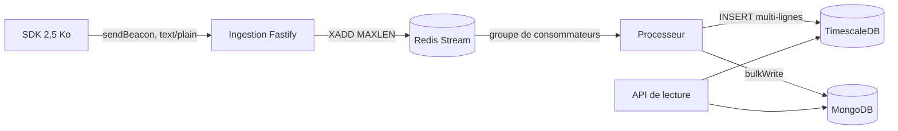

# PerfPulse

[](https://github.com/KarnasZiad/PerfPulse/actions/workflows/ci.yml)
[](https://github.com/KarnasZiad/PerfPulse/actions/workflows/security.yml)
[](LICENSE)

**Real User Monitoring auto-hébergé** : un SDK de 2,5 Ko mesure les Core Web Vitals et les erreurs
JavaScript des vrais visiteurs ; une chaîne d'ingestion Fastify → Redis Streams → TimescaleDB et
MongoDB absorbe les pics ; l'API restitue le 75ᵉ percentile par page, appareil et période.

> Projet de portfolio qui illustre la mission « performance » : budget de taille vérifié en CI,
> ingestion découplée du stockage, agrégats continus et percentiles par histogramme, test de charge.

## Sommaire

- [Ce que mesure PerfPulse](#ce-que-mesure-perfpulse)
- [Architecture](#architecture)
- [Démarrage rapide](#démarrage-rapide)
- [Performance](#performance)
- [Vie privée et sécurité](#vie-privée-et-sécurité)
- [Tests et qualité](#tests-et-qualité)
- [Feuille de route](#feuille-de-route)

## Ce que mesure PerfPulse

| Mesure    | Définition                                                           | Bon              |
| --------- | -------------------------------------------------------------------- | ---------------- |
| LCP       | Affichage du plus grand élément, arrêté à la première interaction    | ≤ 2 500 ms       |
| INP       | Pire interaction, une ignorée par tranche de 50 (≈ p98)              | ≤ 200 ms         |
| CLS       | Plus grande fenêtre de décalages (écart 1 s, fenêtre de 5 s au plus) | ≤ 0,1            |
| FCP, TTFB | Premier rendu et premier octet, mesurés depuis l'activation          | ≤ 1 800 / 800 ms |
| Erreurs   | Non interceptées et promesses rejetées, regroupées par empreinte     | —                |

Le SDK s'intègre en une ligne ([guide](packages/sdk/README.md)) :

```ts
import { init } from '@perfpulse/sdk';

init({ key: 'pk_...', endpoint: 'https://rum.example.ma/v1/collect', release: '2026.10.3' });
```

## Architecture



| Package             | Rôle                                                                                      |
| ------------------- | ----------------------------------------------------------------------------------------- |
| `packages/protocol` | Format de collecte : constantes, seuils de Google, buckets d'histogramme, schéma Zod      |
| `packages/sdk`      | Collecte passive, envoi groupé à la fermeture de la page, aucune dépendance               |
| `apps/ingest`       | Validation, liste d'origines, limitation de débit, enrichissement, écriture du stream     |
| `apps/processor`    | Consommateurs, écritures par lots, reprise des orphelins, file d'erreurs, migrations, CLI |
| `apps/api`          | Session par jeton de lecture, p75, séries, pages, groupes d'erreurs                       |

Détails : [C4](docs/architecture/c4.md), [pipeline d'ingestion](docs/architecture/ingestion-pipeline.md),
[protocole](docs/protocol.md), [modèle de données](docs/database.md),
[ADR](docs/adr/0001-enregistrer-les-decisions-d-architecture.md).

| Couche   | Technologies                                                                  |
| -------- | ----------------------------------------------------------------------------- |
| SDK      | TypeScript, `PerformanceObserver`, `sendBeacon`, esbuild                      |
| Serveurs | Node.js 22, Fastify 5, Zod 4, ioredis (Streams), postgres.js, Pino            |
| Données  | TimescaleDB 2.30 (PostgreSQL 17), MongoDB 8, Redis 7                          |
| Tests    | Vitest, jsdom, `fastify.inject`, Testcontainers, k6                           |
| CI/CD    | GitHub Actions, CodeQL, Trivy, revue des dépendances, Dependabot, images GHCR |

## Démarrage rapide

Prérequis : Node.js 22, Docker et pnpm via Corepack (`corepack enable`).

```bash
pnpm install
cp .env.example .env                      # générer API_TOKEN_PEPPER et SESSION_SECRET
docker compose up -d                      # TimescaleDB, MongoDB, Redis
pnpm --filter @perfpulse/processor db:migrate
pnpm --filter @perfpulse/processor project:create --name "Boutique" --slug boutique \
  --origin http://localhost:5173
pnpm dev                                  # ingestion :4100, processeur, API :4200
```

La commande `project:create` affiche la **clé publique** du SDK et le **jeton de lecture** du
tableau de bord ; ce dernier n'est affiché qu'une fois et n'est stocké qu'en empreinte.

Pile complète depuis les Dockerfiles : `docker compose --profile app up -d --build`.

## Performance

- **Le SDK ne coûte rien au chargement** : observateurs passifs, un seul envoi quand la page est
  masquée, 2,5 Ko compressés ; la CI échoue au-delà de 5 Ko.
- **L'ingestion ne touche aucune base** : projets en mémoire, un `XADD` par lot ; le stream absorbe
  les pics ([ADR 0003](docs/adr/0003-redis-streams.md)).
- **Le stockage écrit par lots** : 200 messages par itération, une instruction `INSERT` par table.
- **Les lectures ne parcourent pas les mesures brutes** : agrégats continus de buckets
  d'histogramme, p75 calculé sur quelques centaines de lignes ([ADR 0004](docs/adr/0004-timescaledb-histogrammes.md)).
- **Les données coûtent peu** : compression après 7 jours, rétention de 30 jours pour le brut et de
  400 jours pour les agrégats.

Test de charge : [`load/collect.js`](load/collect.js) (k6), seuils p99 < 20 ms et 0 échec.

## Vie privée et sécurité

- **Aucune donnée personnelle** : ni IP, ni query string, ni cookie, ni contenu saisi ; chemins
  normalisés (`/orders/18342` → `/orders/:id`). Voir la [politique de données](docs/privacy.md).
- **La clé publique ne suffit pas** : liste d'origines par projet, limitation de débit, robots
  écartés, valeurs aberrantes ignorées.
- **Jetons de lecture** de 238 bits, stockés en HMAC, échangés contre une session signée
  `HttpOnly` `SameSite=Strict` ; un projet hors session répond `404`.
- [Modèle de menaces STRIDE](docs/security/threat-model.md) : 15 menaces et leurs mesures.

## Tests et qualité

```bash
pnpm test:coverage                         # 113 tests unitaires et HTTP, seuils de 85 à 95 %
pnpm test:integration                      # TimescaleDB, MongoDB et Redis réels (Docker requis)
pnpm --filter @perfpulse/sdk size          # budget du SDK
```

| Niveau     | Exemples                                                                                          |
| ---------- | ------------------------------------------------------------------------------------------------- |
| SDK        | Fenêtres de CLS, p98 de l'INP, LCP arrêté à l'interaction, bfcache, aucune exception vers la page |
| Ingestion  | Origine refusée, robots, 413, débit, valeurs aberrantes, aucune IP dans le stream                 |
| Processeur | Empreintes stables entre builds, message empoisonné isolé, reprise d'un consommateur arrêté       |
| API        | p75 à ± 2,5 %, session falsifiée ou expirée, cloisonnement des projets, révocation                |

## Feuille de route

- [x] Conception : cahier des charges, protocole, vie privée, C4, STRIDE, ADR
- [x] SDK, ingestion, processeur, API de lecture
- [ ] Tableau de bord Vue 3 + ECharts
- [ ] Source maps pour déminifier les piles d'appels
- [ ] Alertes : p75 au-delà d'un seuil, nouvelle erreur après une release
- [ ] Navigation des applications monopages (SPA) mesurée vue par vue
