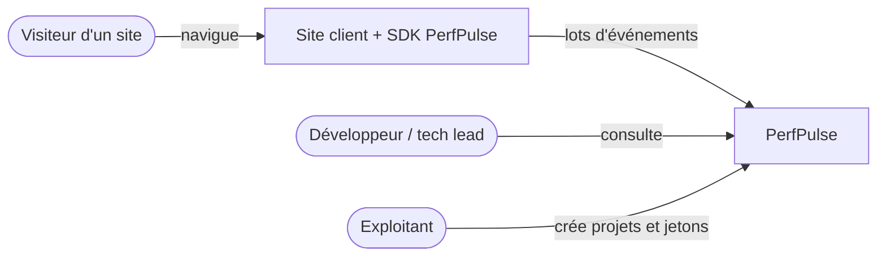
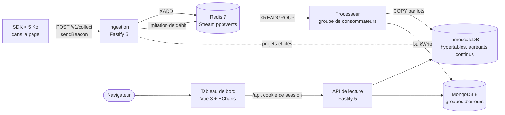
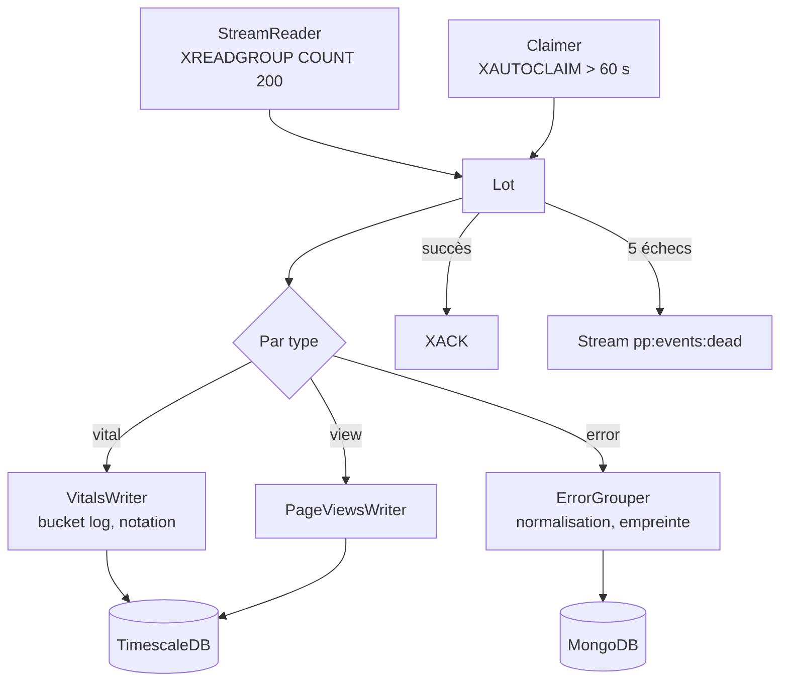

# Architecture C4

## Niveau 1 — Contexte

## Niveau 2 — Conteneurs

| Conteneur       | Responsabilité                                                                  | Mise à l'échelle             |
| --------------- | ------------------------------------------------------------------------------- | ---------------------------- |
| SDK             | Mesure passive, envoi groupé à la fermeture de la page                          | —                            |
| Ingestion       | Valide, filtre par origine, limite le débit, enrichit, écrit dans le stream     | Horizontale, sans état       |
| Redis Stream    | Tampon durable entre la réception et le stockage, absorbe les pics              | Mémoire bornée (`MAXLEN`)    |
| Processeur      | Lit par lots, écrit dans les bases, accuse réception, reprend les orphelins     | Un consommateur par instance |
| TimescaleDB     | Mesures brutes (30 j), agrégats horaires et quotidiens (400 j), projets, jetons | Verticale, compression       |
| MongoDB         | Groupes d'erreurs par empreinte, occurrences d'exemple (14 j)                   | —                            |
| API             | Requêtes du tableau de bord, cloisonnées par projet                             | Horizontale                  |
| Tableau de bord | Graphiques du p75, pages, erreurs                                               | Fichiers statiques           |

L'ingestion ne touche **aucune base** sur le chemin d'une requête : les projets et leurs origines
autorisées sont gardés en mémoire et rafraîchis toutes les 60 secondes.

## Niveau 3 — Composants du processeur

Voir aussi le [pipeline d'ingestion](ingestion-pipeline.md) et le [modèle de données](../database.md).
