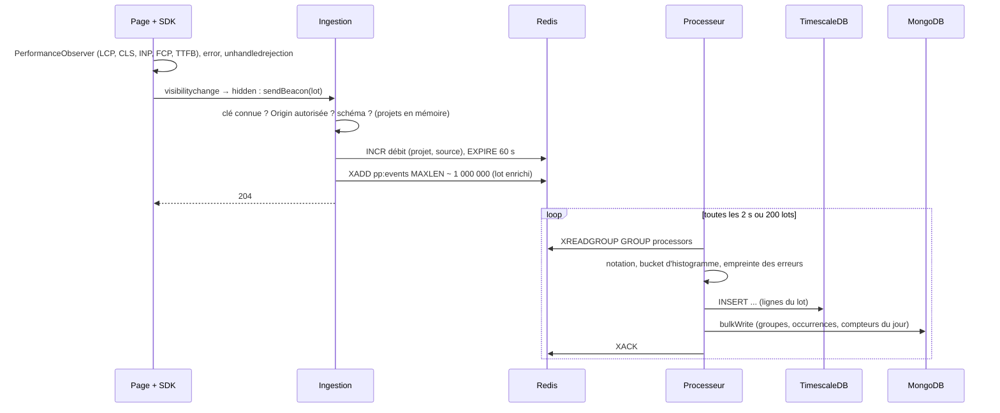

# Pipeline d'ingestion

## D'une page à la base

## Garanties

| Situation                        | Comportement                                                                  |
| -------------------------------- | ----------------------------------------------------------------------------- |
| Pic de trafic                    | L'ingestion répond en quelques ms ; le stream absorbe, le processeur rattrape |
| Processeur arrêté pendant un lot | Le lot reste en attente (PEL) ; un autre le reprend après 60 s (`XAUTOCLAIM`) |
| Lot qui échoue à chaque fois     | Après 5 livraisons, copié dans `pp:events:dead` puis acquitté                 |
| Base indisponible                | Le lot n'est pas acquitté ; les nouveaux s'accumulent dans le stream          |
| Stream plein (`MAXLEN`)          | Les plus anciens lots non lus sont évincés : la mémoire de Redis est bornée   |

La livraison est **au moins une fois** : un lot repris après un crash peut être écrit deux fois.
Pour des percentiles sur des milliers de mesures, un doublon rare est négligeable ; les compteurs
d'erreurs, eux, pourraient être légèrement surestimés. C'est le compromis assumé de l'[ADR 0003](../adr/0003-redis-streams.md).

## Bornes

| Borne                                   | Valeur          | Au-delà                    |
| --------------------------------------- | --------------- | -------------------------- |
| Corps d'une requête                     | 64 Ko           | `413`                      |
| Événements par lot                      | 50              | `400`                      |
| Requêtes par minute (projet, source)    | 600             | `429`                      |
| Longueur du stream                      | ~1 000 000 lots | éviction des plus anciens  |
| Lots lus par itération                  | 200             | lus à l'itération suivante |
| Exemples d'erreur par groupe et par lot | 5               | comptés mais non conservés |
