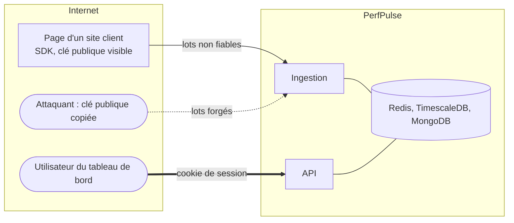

# Modèle de menaces (STRIDE)

## Actifs

| Actif                          | Pourquoi il compte                                                           |
| ------------------------------ | ---------------------------------------------------------------------------- |
| Pages des sites clients        | Le SDK y exécute du code : une faille ou un ralentissement les touche toutes |
| Mesures et erreurs d'un projet | Révèlent l'architecture, les incidents et parfois des données saisies        |
| Jetons de lecture              | Donnent accès au tableau de bord d'un projet                                 |
| Disponibilité de l'ingestion   | Une ingestion saturée perd les mesures de tous les projets                   |

## Frontières de confiance

La clé de projet est **publique** par nature : elle est dans le code de la page. Tout ce qui arrive
à l'ingestion doit donc être traité comme forgé.

## Menaces et mesures

| ID  | STRIDE                 | Menace                                                        | Mesures                                                                                                    |
| --- | ---------------------- | ------------------------------------------------------------- | ---------------------------------------------------------------------------------------------------------- |
| S1  | Spoofing               | Envoi de fausses mesures avec une clé copiée                  | Liste d'origines autorisées par projet, limitation de débit, valeurs aberrantes écartées                   |
| S2  | Spoofing               | Usurpation d'un utilisateur du tableau de bord                | Jeton de 256 bits stocké en empreinte HMAC, échangé contre un cookie `HttpOnly` `SameSite=Strict` signé    |
| T1  | Tampering              | Injection dans les bases via les champs collectés             | Schéma Zod strict et borné, requêtes paramétrées, aucun opérateur MongoDB construit depuis un champ        |
| T2  | Tampering              | XSS stocké : message d'erreur affiché dans le tableau de bord | Échappement Vue (jamais `v-html`), CSP stricte sans `unsafe-inline`                                        |
| T3  | Tampering              | Le SDK perturbe la page hôte                                  | Aucune modification du DOM, chaque point d'entrée protégé par `try/catch`, aucun polyfill global           |
| R1  | Repudiation            | Contester une donnée affichée                                 | Horodatage de réception, release et notation conservés avec chaque mesure                                  |
| I1  | Information disclosure | Données personnelles dans les URL ou les erreurs              | Query string et fragment retirés par le SDK et à nouveau par l'ingestion ; messages tronqués               |
| I2  | Information disclosure | Lecture des données d'un autre projet                         | Projet résolu depuis la session à chaque requête ; projet hors session : `404`                             |
| I3  | Information disclosure | IP des visiteurs                                              | Utilisée en mémoire pour la limitation de débit, jamais écrite (ni base, ni logs)                          |
| D1  | Denial of service      | Saturation de l'ingestion                                     | Corps ≤ 64 Ko, 50 événements par lot, débit limité, aucune base sur le chemin de la requête                |
| D2  | Denial of service      | Redis rempli par un afflux de lots                            | `MAXLEN` approximatif sur le stream : mémoire bornée, éviction des plus anciens                            |
| D3  | Denial of service      | Lot empoisonné qui fait échouer le processeur en boucle       | Isolement après 5 livraisons dans `pp:events:dead`, les autres lots continuent                             |
| D4  | Denial of service      | Explosion de cardinalité (milliers de chemins uniques)        | Chemins bornés à 512 caractères, segments numériques et identifiants remplacés par `:id`                   |
| E1  | Elevation of privilege | Jeton de lecture utilisé pour écrire                          | L'API n'expose aucune route d'écriture de données ; création de projets en CLI uniquement                  |
| E2  | Elevation of privilege | Dépendance compromise                                         | Lockfile, actions épinglées par SHA, Dependabot, Trivy, CodeQL, revue des dépendances, SDK sans dépendance |

## Risques résiduels acceptés

| Risque                                                       | Raison                                             | Plan                                  |
| ------------------------------------------------------------ | -------------------------------------------------- | ------------------------------------- |
| Mesures forgées depuis un outil qui imite l'en-tête `Origin` | L'`Origin` n'est fiable que venant d'un navigateur | Détection d'anomalies par source (v2) |
| Doublons rares après la reprise d'un lot                     | Livraison au moins une fois (ADR 0003)             | Clé d'idempotence par lot (v2)        |
| Donnée personnelle dans le chemin même d'une URL             | Le SDK ne peut pas tout deviner                    | Règles de masquage configurables (v2) |
